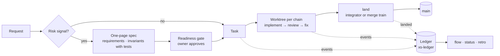

<h1 align="center">Extreme Specification (XS)</h1>

<p align="center">
  <strong>A method for autonomous programming. People specify; agents build, verify and integrate.</strong>
</p>

<p align="center">
  <a href="https://github.com/extremespecification/xs/actions/workflows/test.yml"></a>
  <a href="LICENSE"></a>
  <a href="https://agentskills.io"></a>
  
</p>

<p align="center">
  <a href="https://extremespecification.com"><strong>extremespecification.com</strong></a>
</p>

<p align="center">
  <a href="#quick-start">Quick start</a> ·
  <a href="PROTOCOL.md">The protocol</a> ·
  <a href="docs/README.md">Guides</a> ·
  <a href="docs/reference.md">Reference</a> ·
  <a href="EVIDENCE.md">Evidence</a> ·
  <a href="CHANGELOG.md">Changelog</a> ·
  <a href="CONTRIBUTING.md">Contributing</a>
</p>

---

Extreme Programming turned the practices that worked up to the maximum, because writing code was the bottleneck. With coding agents, code is cheap and **human attention is scarce**. XS turns up the specification instead: a spec is one page, every requirement has an id, every invariant (a rule of the domain that must always hold) has a test, and the spec records decisions while the work goes on. "Extreme" refers to rigor, not length.

Four values follow: **specifications over conversations, proof over claims, integrated work over finished work, enforced rules over written rules.**

The [website](https://extremespecification.com) explains the method in one page; this repository holds the protocol, the guides and the toolset.

## Why XS

Agents write code faster than anyone can read it. What runs short is not code but the attention of the person who owns the work. In our projects it went to five things:

- finished work nobody could find, and the same "is it on main?" asked again and again;
- agents in one tree overwriting each other;
- teams stopped by a usage limit, with nobody to resume them;
- the same correction given in session after session;
- the state of the work kept in a chat that the next session never sees.

XS answers each with a rule, and each rule cites the observation behind it ([EVIDENCE.md](EVIDENCE.md)). Where a check can enforce a rule, a check does: a test, a hook, a gate.

## How it works



- **You decide what and how good; agents decide how.** A request with a risk signal (an intent gap, a wide footprint, an invariant touched) starts from a one-page spec. Any other request becomes a task, and an agent builds it.
- **Every rule of the domain has a test** whose name cites it (`S04 I2 ...`). Agents never weaken one, and a spec is not ready while a test is missing.
- **State lives in a ledger, not in a chat.** Work is a task; its state changes only through `xs`, which records one event per change on `xs-ledger`, a branch with no history in common with `main`. `main` receives only the work.
- **Agents work in parallel, on the trunk.** Tasks that touch the same files form a chain; each chain runs in its own git worktree, on its own short-lived branch. `land` hands a finished branch to the integrator, which brings branches onto `main` in rounds with one run of the full checks per round, or to GitHub's merge queue or GitLab's merge train.
- **One flow at any hour.** There is no night mode: a factory left running follows the same rules, works only approved specs, and schedules its own resume after a usage limit.
- **The method measures itself.** `flow` reads the ledger: lead time, tasks filed per task closed, questions waiting for you. The retrospective turns the corrections you keep repeating into rules; the curator keeps memory in step with the code between retrospectives.

## Quick start

Requirements: git, bash, python3 (3.9 or later), and a coding agent that reads skills of the open [Agent Skills](https://agentskills.io) standard (every such tool gets the skills; Claude Code also gets role definitions and hooks).

```sh
git clone https://github.com/extremespecification/xs.git ~/xs
export PATH="$HOME/xs/scripts:$PATH"   # add it to your shell profile
xs install                             # links the skills into each agent tool it finds; idempotent

cd your-repo
xs init                                # adds AGENTS.md and project/, keeps every file you have, creates the ledger
```

Fill each `<...>` of `AGENTS.md` (the stack, the commit rules), give `make` a `check` target (the command a change must pass), and commit. Then ask your agent for a small change:

> Fix the date column of the invoice table: it shows UTC instead of the user's time zone. Use the lead skill.

The lead agent files a task in the ledger, builds the fix in a git worktree of its own, has a reviewer agent read the diff, brings it onto `main` with `land`, and reports in four lines. [Getting started](docs/getting-started.md) walks through it.

## Adopt it in levels

Each level is complete on its own. Move up when its symptom appears, never by calendar ([PROTOCOL §0](PROTOCOL.md#levels)).

| Level | Adds | Adopt it when |
|---|---|---|
| **1. Spec** | the one-page spec, invariants bound to tests, the readiness gate, review; no scripts | always: this is XS |
| **2. Land** | a worktree per chain, `land` and its integrator (a local merge train), the `guard` hook, parallel agents | agents work in parallel, or "is it on main?" comes up twice |
| **3. Ledger** | state through `xs`, the event log, `flow`, a factory left running | work is lost between sessions, or you cannot say where the time goes |
| **4. Memory and scale** | memory entries, the retrospective, the curator, teams | the same correction is given twice, or a second team adopts XS |

## Documentation

| Read | To |
|---|---|
| [extremespecification.com](https://extremespecification.com) | understand the method in five minutes |
| [Getting started](docs/getting-started.md) | prepare a repo and land a first task |
| [The guides](docs/README.md) | follow one worked example, phase by phase |
| [PROTOCOL.md](PROTOCOL.md) | know every rule, its level and its evidence |
| [Reference](docs/reference.md) | look up a command, a setting or an event |
| [CHANGELOG.md](CHANGELOG.md) | see what each release changed |

## Use

| You want | Ask or run |
|---|---|
| to think an idea through, or to know where things stand | the `advisor` skill, in a session of its own |
| a feature specified, or a batch of tasks built by a team of agents | the `lead` skill |
| the state of every task, spec and agent | `xs status`, or `xs status --since <time>` for what changed |
| to see what is not on `main` yet | `xs where` |
| a branch on `main` | `land`, from its worktree |
| to hand a task to another session, account or tool | `xs handoff T12 --next "..."`, then `xs takeover T12` |
| the method's numbers | `flow` |
| the rules your corrections suggest, every two weeks | the `retro` skill |
| memory kept in step with the code, each day | the `curator` skill |

[docs/reference.md](docs/reference.md) lists every command, setting and event; `xs --help` prints the commands.

## Features

| | |
|---|---|
| **Ledger** | Append-only event log on its own branch, one commit per command, pushed and pulled in a team. Readable as text by any agent: `xs status`. |
| **Gates** | Readiness gate for specs (configurable owner approval), merge gate for code, a person for every irreversible action. |
| **Integrator** | Local merge train: rebases every queued branch together, runs the gate once per round, bisects a red round to the guilty branch. With a forge, `land` queues in GitHub's merge queue or GitLab's merge train and `xs sync` records what it merged and what it held back. |
| **Guard** | A hook that denies sweeping commits, killing other sessions' processes and moving `main` outside `land`; asks before anything leaves the machine; refuses a spawn of a generic subagent that names no model. Its JSON contract is tool-neutral, so an [Agent Client Protocol](https://agentclientprotocol.com) client can use it as its permission policy. |
| **Agent status** | `agent.started`, `agent.stopped` (with the reason and when a usage limit resets) and `agent.finished`, recorded by hooks and by `xs start --run`, shown by `xs status`. |
| **OpenTelemetry** | Set `OTEL_EXPORTER_OTLP_ENDPOINT` and every agent run is exported as an OTLP span named by the GenAI semantic conventions. No dependency. |
| **Handoff** | `xs handoff` packages a task (brief, branch head, uncommitted work as a patch, open requests); `xs takeover` resumes it in any tool, on any account. |
| **Memory** | Agents propose entries; the owner promotes them into `AGENTS.md`, `DESIGN.md` or `CONTEXT.md`. Each entry is anchored to code and goes stale when that code changes. |
| **Measurement** | Seven core numbers from the ledger (`flow`), a retrospective every two weeks, and a curator that keeps memory true. |

## How XS differs

| | XS | Spec-driven tools (GitHub Spec Kit, Kiro) | BMAD |
|---|---|---|---|
| When a spec is written | only when one of three risk signals holds | for every feature | for every feature, through several documents |
| Size of a spec | one page per change | several files per feature | a document per phase |
| What binds the code | invariants, each with a named test | requirements and a design | requirements, architecture and stories |
| Human approval | the spec and each irreversible action; the merge is autonomous | each phase | each phase |
| How the method changes | repeated corrections become rules and checks, measured by `flow` | by hand | by hand |

## Repository layout

| Path | Purpose |
|---|---|
| [`PROTOCOL.md`](PROTOCOL.md) | the method: seven principles, eleven sections, each rule with its level and evidence |
| [`EVIDENCE.md`](EVIDENCE.md) | the observations the rules cite |
| [`docs/`](docs/README.md) | the guides, one page per phase, with a worked example |
| `skills/` | the sessions you run (`lead`, `advisor`, `retro`, `curator`) and the roles they hand work to (`researcher`, `implementer`, `reviewer`) |
| `scripts/xs` | the only writer of the ledger |
| `scripts/land`, `scripts/where`, `scripts/flow`, `scripts/next-id` | landing, what is not on `main`, the numbers, the next free id |
| `adapters/claude-code/` | role definitions, the `guard` hook and the `lifecycle` hook; another tool's adapter is a folder beside it |
| `template/` | what `xs init` copies into a repo and its ledger |
| `test.sh` | end-to-end tests of every script and hook, in temporary repos |
| `evals/` | an evaluation of the curator skill against a real model; not part of `test.sh` |

In zsh, run `xs where` and `xs land`: zsh's builtin `where` hides the script.

## Status

XS emerged from building about a dozen products with coding agents, from desktop apps to open-source libraries. Its rules answer problems observed in that work; the effect of a rule after its adoption has not been measured, and a rule with no observation behind it says `Evidence: none`. The rules for teams ([Adopt in a team](docs/adopt-in-a-team.md)) are designed, not yet measured. Today only Claude Code has an adapter.

Expect the method to change until 1.0; [CHANGELOG.md](CHANGELOG.md) records each release. The format of the ledger's events is the stable contract.

## Contributing

Evidence from your own work is the most valuable contribution, above all from teams. Read [CONTRIBUTING.md](CONTRIBUTING.md) for how to propose a rule and how to change the scripts. Report a vulnerability privately, as [SECURITY.md](SECURITY.md) says.

## Credits

- Extreme Programming, for the name and the idea of turning a practice that works up to the maximum.
- The [BMAD method](https://docs.bmad-method.org/), for finding triage, neutral research questions and the test for a shared decision.
- DeepSeek's [dsh-superagent](https://github.com/deepseek-ai/dsh-superagent-prototype), for judging each part by the human attention it costs.

## License

[MIT](LICENSE)
